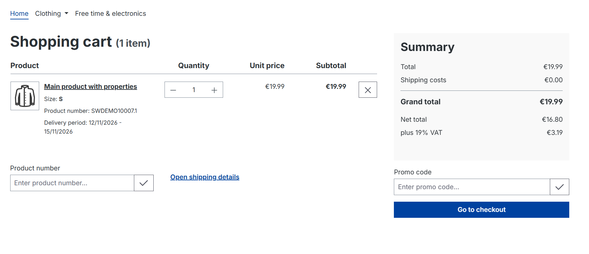
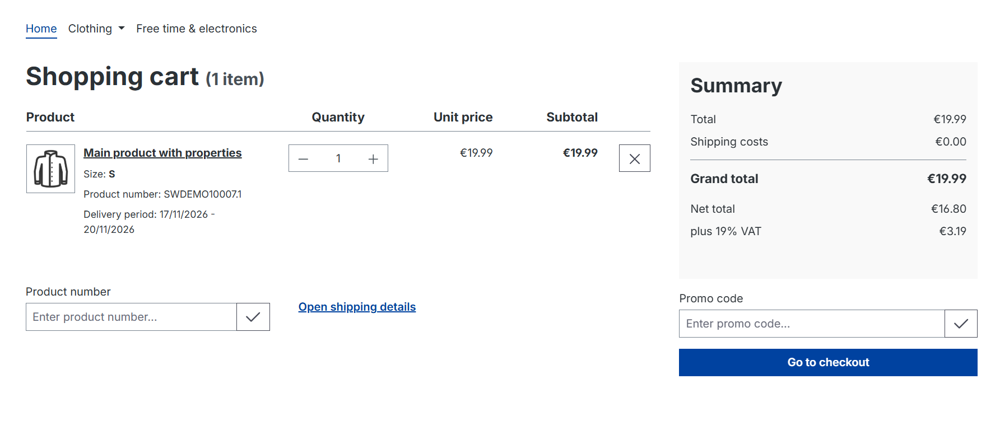
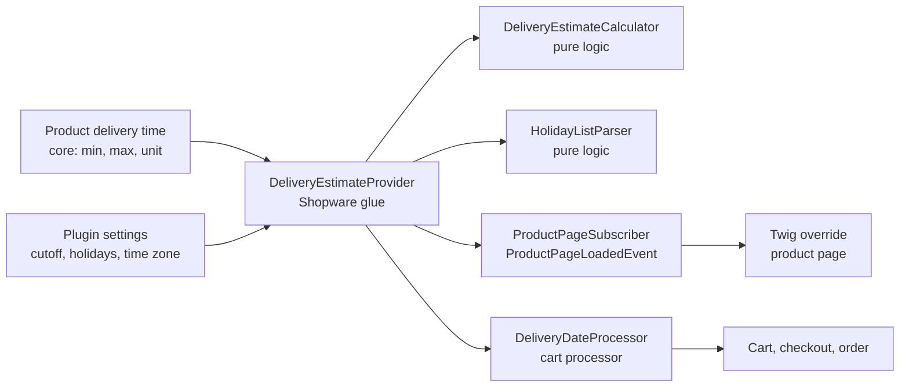

# Delivery date estimate for Shopware 6

A Shopware 6.7 plugin that turns a product's delivery time ("2-5 days") into real delivery dates that skip weekends and holidays and respect an order cutoff — on the product page **and** in the cart, checkout and the saved order.


## The problem

Shopware already has delivery times, and in the cart it even turns them into dates. But it counts **calendar days**:

| | Core Shopware | With this plugin |
|---|---|---|
| Order on Tue 10 Nov 2026, "2-5 days" | 12/11 – **15/11 (a Sunday)** | 12/11 – 17/11 |
| Order after the cutoff (14:00) | same dates as at 08:00 | counts from the next working day |
| Order on 23 Dec at 15:00, "2-3 days" | happily promises 25 Dec | skips holidays and the weekend: 30 Dec – 4 Jan |
| Product page | "2-5 days" only | "Arrives between Thu, 12 Nov and Tue, 17 Nov" plus "Order before 14:00 to ship today" |

| Before (core) | After (plugin) |
|---|---|
|  |  |

## Features

- Concrete delivery date range on the product page, under core's delivery time line
- "Order before 14:00 to ship today" when ordering now still counts from today
- Corrected delivery dates in the off-canvas cart, cart page and checkout
- Dates are stored with the order (`order_delivery.shipping_date_earliest/latest`), so the confirmation email, customer account and admin show them too
- Holiday list: `MM-DD` for fixed yearly holidays, `YYYY-MM-DD` for one-off dates (e.g. Easter)
- Optional business-days-only counting, configurable cutoff hour and shop time zone
- All settings per sales channel; English and German admin and storefront texts

## How it works



1. **`DeliveryEstimateCalculator`** — pure PHP, no Shopware classes, no clock. Given min/max/unit, "now", the cutoff, the business-days switch and holidays, it returns the earliest and latest date and the cutoff deadline.
2. **`HolidayListParser`** — pure PHP. Turns the text the shop owner types into a list of dates; invalid lines are reported, never fatal.
3. **`DeliveryEstimateProvider`** — the only class that knows Shopware: reads the settings per sales channel, creates "now" in the shop time zone, logs problems and returns "no estimate" instead of breaking a page.
4. **`ProductPageSubscriber`** attaches the estimate to the product page as an extension; a Twig override (`sw_extends` + `parent()`) renders it below core's text.
5. **`DeliveryDateProcessor`** is a cart processor that runs right after core's `DeliveryProcessor` (priority -5100 vs. -5000) and replaces its dates per cart line and per delivery.

Product page and checkout both go through the same provider, so the promise is always identical.

## Design decisions

- **Build on core, don't replace it.** The first version added its own "lead time" custom field — until it turned out core already has delivery times. The plugin now reads core's delivery time and only adds what core lacks.
- **Pure domain logic, thin framework glue.** The calculator and parser take every input as a parameter, including "now". That makes every rule testable with fixed dates (e.g. "23 Dec at 15:00") and lets the tests run without booting Shopware.
- **Correct the cart, not just the template.** Changing only the cart Twig would show nicer dates but save core's into the order. The cart processor fixes the data itself, so order, email and admin agree.
- **No stacking.** Shopware rebuilds the cart from scratch on every calculation, so the processor corrects fresh core dates each time instead of shifting already-shifted ones.
- **Fail soft.** A mistyped holiday, an unknown time zone or an unusual delivery time unit is logged and falls back to core's behaviour. A settings typo must never break the storefront.
- **Out-of-stock lines are left to core**, which adds the restock time. In a mixed delivery, they still count toward the overall date, so the plugin never promises too early.
- **"Order before 14:00" instead of a live countdown.** Product pages can be served from Shopware's HTTP cache for hours, so a "3 h 20 min left" text would go stale. A fixed time stays true until the cutoff.

## Settings

Extensions → My extensions → Delivery date estimate → Configure (per sales channel):

| Setting | Default | Notes |
|---|---|---|
| Show delivery date estimates | on | |
| Order cutoff (hour) | 14 | Orders before 14:00 on a working day count from today. |
| Shop time zone | Europe/Berlin | IANA name; used for "today" and the cutoff. |
| Count business days only | on | Off = calendar days (core's behaviour, but with holidays and cutoff). |
| Holidays | German nationwide fixed holidays + 24/31 Dec | One per line, text after the date is a note. |

## Installation

Requires Shopware 6.7.

```bash
# copy or clone into custom/plugins/MsLeadTime, then:
bin/console plugin:refresh
bin/console plugin:install --activate MsLeadTime
bin/console cache:clear
```

Products need a delivery time (Catalogues → Products → Delivery time) to get an estimate.

### Local development

A [Dockware](https://dockware.io) setup is enough. `compose.yaml` one level above this folder:

```yaml
services:
  shopware:
    image: dockware/shopware:6.7-latest
    container_name: shopware
    ports:
      - "81:80"
    volumes:
      - "./MsLeadTime:/var/www/html/custom/plugins/MsLeadTime"
```

## Tests

19 unit tests cover the calculator and the holiday parser: cutoff boundaries, weekends, holidays, Christmas/New Year, leap days, weeks and hours, invalid input — plus one test that reproduces core's Sunday date on purpose.

```bash
docker exec shopware curl -sSLo /tmp/phpunit.phar https://phar.phpunit.de/phpunit-11.phar
docker exec -w /var/www/html/custom/plugins/MsLeadTime shopware php /tmp/phpunit.phar
```

## Known limitations

- Weeks, months and years are approximations (5 / 20 / 250 working days).
- Moving holidays (Easter, Whit Monday) must be entered as full dates each year.
- The cutoff is a whole hour; no minutes.
- One holiday list per sales channel, not per shipping country or carrier.
- No integration tests yet for the subscriber and cart processor; they are checked manually against the demo shop.

## Ideas for later

- Live JavaScript countdown that works with the HTTP cache
- Public-holiday presets per country/state (e.g. Bavaria adds 6 Jan and 1 Nov)
- Per-shipping-method handling days and cutoffs
- Integration tests with Shopware's test kernel

## License

MIT
